<p align="center">
  
</p>

<p align="center"><strong>Learn what you've always wanted to</strong></p>

Unfurl turns a learning goal into a researched course with explanations, experiments, and varied practice. Discuss what you want to understand, review the program, then learn through activities chosen for the work the subject actually requires.

A course has a shared structure; each learner has their own saved progress, evidence, and route through additional support. You can move from understanding a worked example to making decisions, testing an idea, and applying it independently.

<p align="center">
  <a href="https://unfurl-inky.vercel.app"><strong>Open Unfurl</strong></a>&nbsp;&nbsp;
  <a href="https://unfurl-inky.vercel.app/media/unfurl-film.mp4"><strong>Watch demo</strong></a>&nbsp;&nbsp;
  <a href="#run-locally">Run locally</a>&nbsp;&nbsp;
  <a href="docs/setup.md">Configuration and deployment</a>
</p>

<p align="center">
  
  
  
  
</p>

https://github.com/user-attachments/assets/062c6489-89b8-4be2-833c-195e346c80cc

## Contents

- [From a question to a course](#from-a-question-to-a-course)
- [Practice that fits the subject](#practice-that-fits-the-subject)
- [A shared course, personal progress](#a-shared-course-personal-progress)
- [How the system works](#how-the-system-works)
- [Run locally](#run-locally)
- [Configuration and deployment](#configuration-and-deployment)
- [Storage and access](#storage-and-access)
- [Checks and current limits](#checks-and-current-limits)
- [Repository map](#repository-map)
- [Credits](#credits)

## From a question to a course

Start with an outcome: “I want to understand how machine learning works, then build models and AI systems myself.” Include the background you already have, the language you want to study in, and any practical constraints. The interface is English; a course can use another language.

[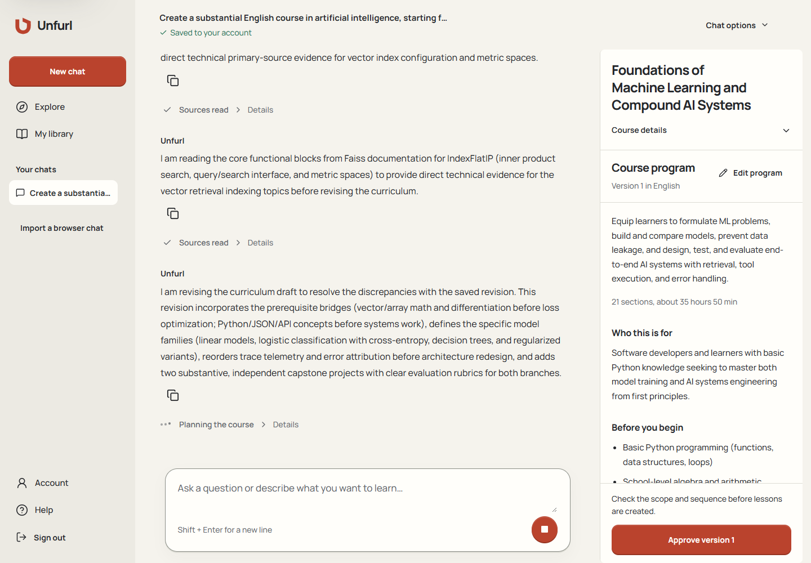](docs/images/course-authoring.png)

*Research and a saved AI curriculum in an actual authoring conversation.*

1. **Discuss and research.** The agent replies in the conversation, searches for sources, reads web pages and text-based PDFs, and develops the program. Expandable actions show what happened. A conversation can contain several separate course artifacts.
2. **Review the program.** Inspect the goal, audience, prerequisites, learning outcomes, module order, and estimated study time. Edit the program or ask for a revision. Course details and language belong to the selected artifact.
3. **Approve that version.** Approval applies to the exact saved program. It appears in the conversation as **Plan approved**, and the artifact shows **Approved**. Approval waits until the authoring agent has finished.
4. **Follow construction in the chat.** The build researches sections, checks coverage of the approved outcomes, plans lessons, writes reading material, creates activities, and validates them. Work is saved in separate steps. Failure and retry remain visible; a stopped build is never presented as a ready course.
5. **Begin when the course is ready.** The ready course offers study and course-detail actions. The library keeps created courses and enrollments; chat history stays in the chat.

A new conversation is created on the first send, not while an unsent first message is being typed. Returning to an existing chat restores its saved messages and writing. Stop, retry, and revision operations preserve the identity of the work they affect.

[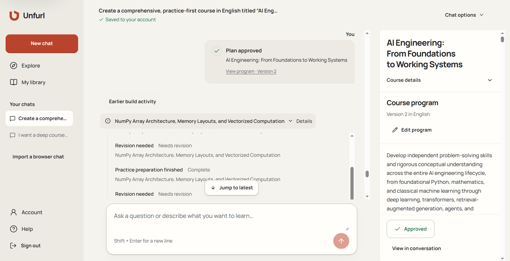](docs/images/course-program.png)

*The approved program stays beside the conversation, with earlier build activity available for review.*

Refine the sample goal with a constraint such as “I know basic Python, but need the mathematics explained through experiments.” Inspect the resulting prerequisites and section order, then ask for a targeted change before approval. The same flow applies to another subject or learning language.

[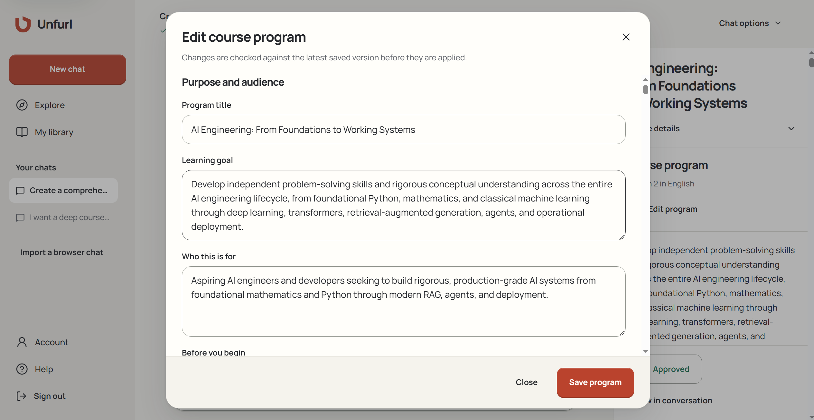](docs/images/edit-program.png)

*Edit the program's title, learning goal, and audience. Changes are checked against the latest saved version before they are applied.*

[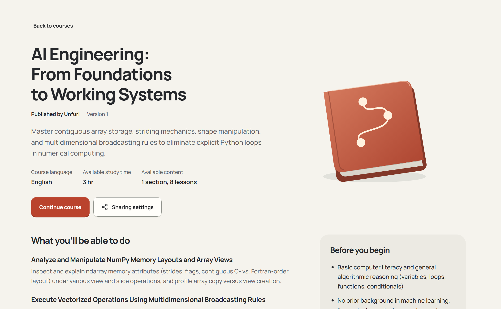](docs/images/ready-course.png)

*A published course brings its learning outcomes, prerequisites, and available content together.*

## Practice that fits the subject

Unfurl defines **29 activity families**. The generator chooses from their actual capabilities: what the learner can manipulate, construct, observe, explain, or test, and how the result can be assessed. A course does not have to use every family.

| Learner action | Examples of supported activity families |
| --- | --- |
| Reconstruct and distinguish | Recall reconstruction, confusable discrimination, rule induction, procedure reconstruction |
| Explain a process | State tracing, outcome prediction, cause diagnosis, self-explanation |
| Investigate | Experimental investigation, causal intervention, source investigation |
| Connect representations | Relational mapping, analogy transfer, representation translation, estimation |
| Build and improve | Example or counterexample construction, plan and artifact construction, diagnosis and repair, adversarial testing, constrained optimization |
| Communicate and reason | Argument and rebuttal, critique and revision, misconception tutoring, information gap, role simulation, audience mediation |
| Choose an approach | Strategy selection |

Activities share a player, but use different response schemas, controls, and evaluators. Deterministic answers are checked on the server; open responses use criterion-based review; supported Python work runs in an isolated sandbox. Investigation and dialogue tasks save actual actions and observations before evaluating the answer that cites them.

[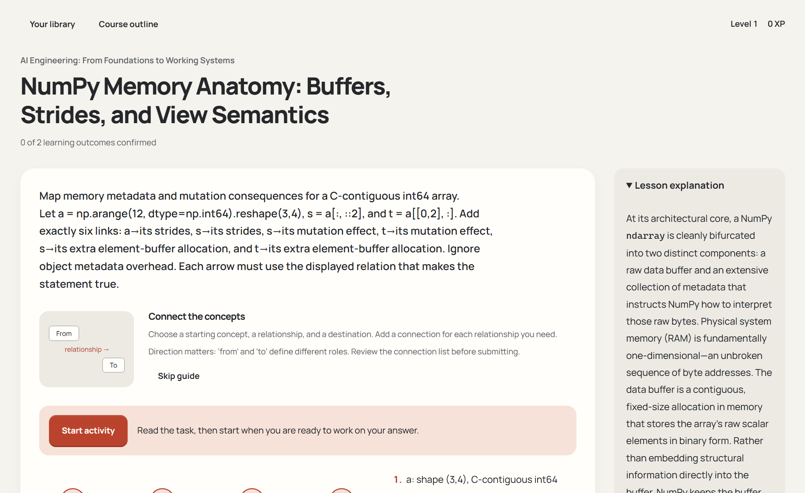](docs/images/learning-workspace.png)

*The activity and its lesson explanation stay together in the learning workspace.*

The generator checks its own proposed exercises with valid, alternative-valid, and meaningfully wrong cases, then requests an independent content review. A typed response alone is insufficient: sources, criteria, references, task behavior, and the full approved outcome must agree before release.

[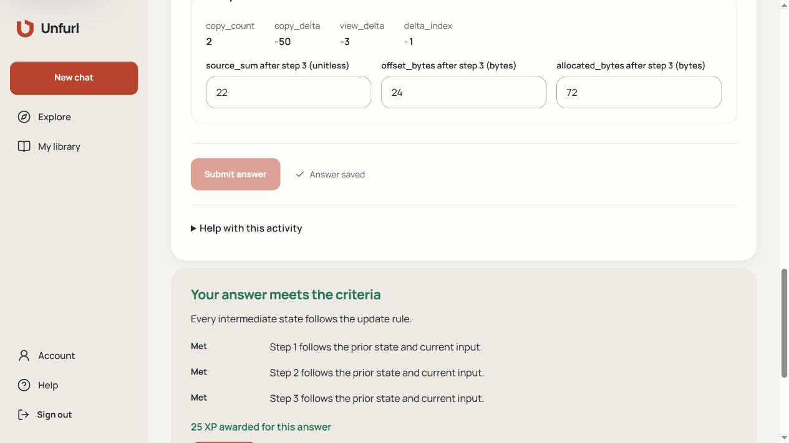](docs/images/activity-state-tracing.png)

*Trace intermediate values, save the answer, and receive feedback on each step.*

## A shared course, personal progress

An enrollment pins a learner to a particular course version. The course's required outcomes remain stable while additional practice, diagnostics, or challenges can respond to the learner's evidence. Support can be accepted or declined, with a route back to the main program. A simple mistake does not automatically require a large detour.

Feedback distinguishes correct, partial, incorrect, uncertain, and unavailable results. Uncertainty is not treated as the learner being wrong. Hints and worked examples remain separate from independent evidence; learners can request review of feedback.

The server awards **25 XP** for an independently correct eligible task or **10 XP** when a hint was used. A revealed worked example does not earn XP. Repeated submissions of the same task do not multiply an award. Each 250 XP advances a level; public publication becomes available at level 3, or **500 XP**.

[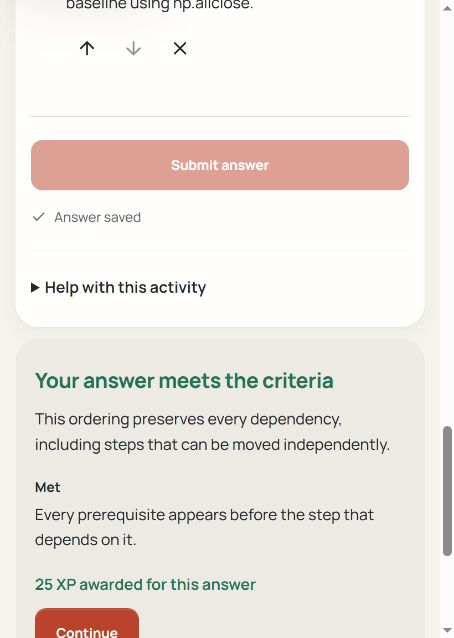](docs/images/activity-procedure.png)

*Feedback after completing a procedure-ordering activity.*

Creators can keep a course private, share a particular version through a revocable link, or publish an eligible ready version. A recipient starts their own enrollment and cannot see the creator's answers. New course versions do not silently rewrite an existing learner's work.

[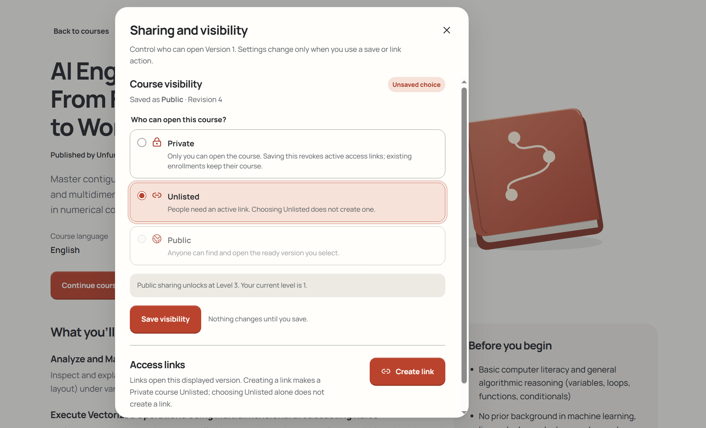](docs/images/course-visibility.png)

*Choose course visibility and manage access links. A selection is applied when it is saved.*

[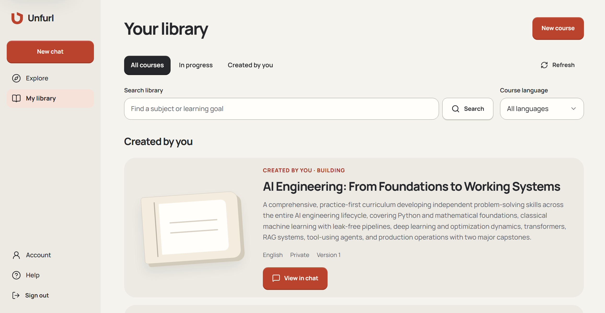](docs/images/course-library.png)

*A created course appears in the library while its content is being built. View in chat returns to its saved conversation.*

The **Try** entry opens a selected public course in the learning workspace and preserves that destination through sign-in. Each learner starts with their own progress. The configured course and version must remain published and accessible.

## How the system works

The application separates conversation, curriculum approval, course construction, and learning. A successful agent reply does not imply a ready course; only validated, atomically released content can be studied.

### Building a course

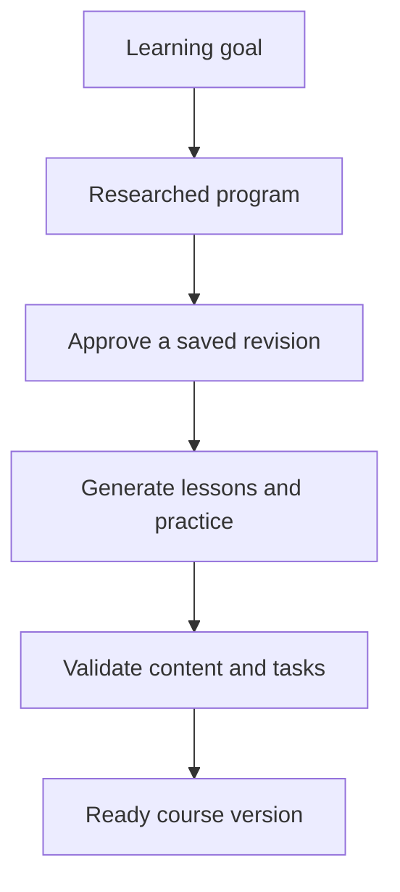

Source research informs the program and each section. The build saves its work between steps, and validation checks the proposed content before a version becomes available to learners.

### Learning from the course

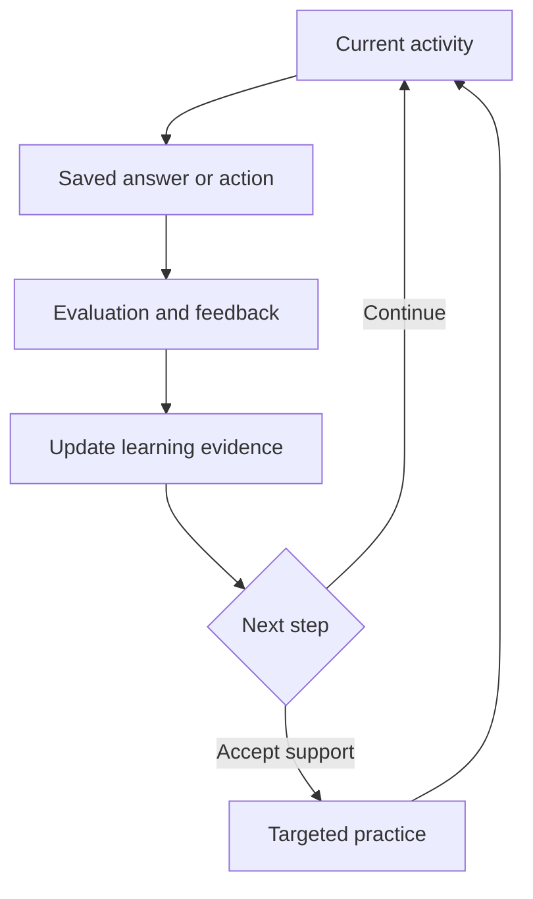

Each enrollment stays attached to its course version. Feedback updates the learner's evidence and eligible XP; additional support has a route back to the main program.

### Services and responsibilities

- **Next.js and React** provide the interface and ordinary authenticated HTTP endpoints. Typed events and snapshots reconnect long-running work to the conversation.
- **Supabase Auth and PostgreSQL** store identity, conversations, course versions, attempts, evaluations, progress, and execution records. Mutations check the current actor, ownership, revision, and idempotency key.
- **Vercel Workflow** continues durable jobs independently of an open browser. Steps have leases, saved results, and explicit recovery; provider effects are recorded before their result becomes usable.
- **OpenRouter** supplies model inference and web search. Gemini 3.8 Flash handles structured authoring and course content; Kimi K2.6 handles search and rubric evaluation. Saved operations preserve the model and request used by each step so a retry can recover the same work.
- **Source reading** extracts text from web pages and PDFs. Long PDFs are saved in parts with their original page numbers and read through continued source requests. A partial extract is not treated as evidence that the complete document was read.
- **Vercel Sandbox** runs supported Python activities in temporary environments with no guest network access and strict execution limits.
- **Zod and server validators** enforce data shapes, provenance, coverage, public/private separation, and admissible state transitions. The UI cannot award XP or declare its own build complete.

For the component boundaries, data model, HTTP contracts, and failure behavior, see the [technical specification](devpost/spec.md).

## Run locally

Use **Node.js 22.x** and npm. The dependency versions are pinned in [package-lock.json](package-lock.json).

```sh
git clone https://github.com/DarinaX2005X/hackathon-ai.git
cd hackathon-ai
npm ci
```

Create `.env.local` from [.env.example](.env.example), supply the services for the functionality you need, and follow the [setup guide](docs/setup.md). The guide covers Supabase Auth, database migrations, OpenRouter, dispatch, sharing, and optional Python execution through Vercel Sandbox. Keep development services separate from the hosted application.

Account-backed authoring and learning require configured services. Automatic provider initialization for a fresh database is not included; review [runtime capability setup](docs/setup.md#runtime-capability-evidence) before expecting generation and grading to run. Installing packages and supplying an API key alone does not enable those operations.

```sh
npm run dev
```

Open [http://127.0.0.1:3000](http://127.0.0.1:3000) to see the landing page. Both the development server and production-start script bind to `127.0.0.1`. Keep `APP_ORIGIN` aligned with the actual origin. Stop the process with `Ctrl+C`.

For a local production build:

```sh
npm run build
npm run start
```

Local Workflow data uses `.cache/workflow-data` instead of `.next`, so rebuilding does not erase its journal. Use a separate development database and deployment configuration; local and hosted workers must not accidentally process the same active jobs.

## Configuration and deployment

The [setup guide](docs/setup.md) covers environment variables, migrations, provider accounting, share keys, runtime capability checks, local execution, and Vercel deployment. It distinguishes server secrets from public configuration and describes the supported account behavior.

The deployment configuration selects Frankfurt (`fra1`) and a daily recovery dispatch. Normal accepted work also triggers dispatch after the response. Vercel's hosted runtime has finite function deadlines; larger courses continue through saved steps rather than depending on one request lasting for the entire build.

Server-side accounting records provider requests, costs, and unresolved outcomes across retries. Provider and sandbox charges depend on actual use and the deployment's service configuration. A key or installed package alone is not proof that a capability is available.

## Storage and access

| Record | Authoritative location and behavior |
| --- | --- |
| Account, profile, session | Supabase Auth and server-verified session; credentials are not stored in chat data |
| Saved conversations, composer state, course artifacts | PostgreSQL, scoped to the signed-in account |
| Curriculum, approval, generated content | Revision-bound records and immutable ready course versions |
| Learning actions, answers, evaluations, route, XP | Server records belonging to the learner and enrolled version |
| Unsent first message or unsaved edits | Limited browser recovery until a server save is confirmed; not a backup |
| Chats from the earlier local-only version | Browser IndexedDB; explicit import preserves the browser original and does not automatically send messages |
| Share links | Server-verified grants for an exact version; revocation is enforced on access |

Clearing browser storage does not delete work already saved to an account. Deleting a chat does not implicitly delete its courses. Read the in-product [privacy explanation](https://unfurl-inky.vercel.app/privacy) for the current user-facing behavior.

## Checks and current limits

```sh
npm run check
```

The combined check runs route type generation, TypeScript, ESLint, Vitest, and a production build. Live provider and database operator suites require explicit opt-in; a normal test run does not make paid requests.

| Command | Purpose |
| --- | --- |
| `npm run typecheck` | Generate route types and check TypeScript |
| `npm run lint` | Run ESLint |
| `npm test` | Run automated tests, with live suites gated |
| `npm run build` | Compile a production build |
| `npm run check` | Run the complete local check sequence |

The repository tests cover authorization, revision conflicts, duplicate requests, durable recovery, provider accounting, source evidence, generation validation, activity contracts, grading, progression, and interaction state. Live journeys and visual review have separate acceptance criteria in the [verification checklist](devpost/checklist.md).

Current boundaries:

- The interface is English. Course content has its own language.
- Signup uses email and password without sending a confirmation email. Email password recovery is not available in this build.
- Research reads HTML, XHTML, plain text, Markdown, JSON, and the text layer of PDFs. It does not perform OCR on scanned pages or unlock encrypted documents. Inaccessible sources remain explicit failures so another source can be selected.
- Generation, rubric grading, and sandbox execution require available external services, valid capability evidence, and sufficient provider credits and quotas. A failed build retains its approved program and completed work; retry may require additional paid calls.
- The Python sandbox is for bounded exercises, not a persistent notebook or a full local AI training environment. Larger course projects can require tools and resources on the learner's computer.
- Learning effectiveness has not been measured in a controlled study.

## Repository map

| Area | Responsibility |
| --- | --- |
| [src/app](src/app/) | Routes, HTTP endpoints, and page metadata |
| [src/features/creator](src/features/creator/) | Chat, curriculum editing, approval, and build presentation |
| [src/features/learning](src/features/learning/) | Shared learning player and activity renderers |
| [src/features/catalog](src/features/catalog/) and [src/features/library](src/features/library/) | Discovery, course access, created courses, and enrollments |
| [src/domain](src/domain/) and [src/application](src/application/) | Runtime schemas, ports, and HTTP adapters |
| [src/server](src/server/) | Auth, research, generation, grading, progression, sharing, and durable execution |
| [src/components](src/components/) and [src/styles](src/styles/) | Shared controls, shell, tokens, and layout |
| [supabase](supabase/) | Ordered migrations and explicit provisioning/verification tools |
| [public/brand](public/brand/), [public/media](public/media/), and [docs/images](docs/images/) | Product identity, demo film, and real documentation images |
| [tests](tests/) and [scripts](scripts/) | Automated checks and operational verification |

Product documents: [scope](devpost/scope.md), [requirements](devpost/prd.md), [technical specification](devpost/spec.md), and [verification checklist](devpost/checklist.md).

## Credits

Planning follows the applicable [Devpost Learn Skill Pack](https://github.com/challengepost/learn-ai-basics) scope, product-requirements, and technical-specification structures.

Unfurl uses Next.js, React, TypeScript, Zod, Supabase, Vercel Workflow and Sandbox, and OpenRouter. Radix supports dialogs and menus, Lucide supplies icons, Fontsource supplies Manrope, and unpdf provides PDF text extraction. The logo and unfolding course illustration are authored product assets; the screenshots show actual application states.

Third-party dependencies retain their own licenses. See [third-party notices](THIRD_PARTY_NOTICES.md) for the adapted Kimi chat-template material. No project license is declared here.

## License

Unfurl is released under the [MIT License](LICENSE). Third-party material keeps its own license; see [THIRD_PARTY_NOTICES.md](THIRD_PARTY_NOTICES.md).
