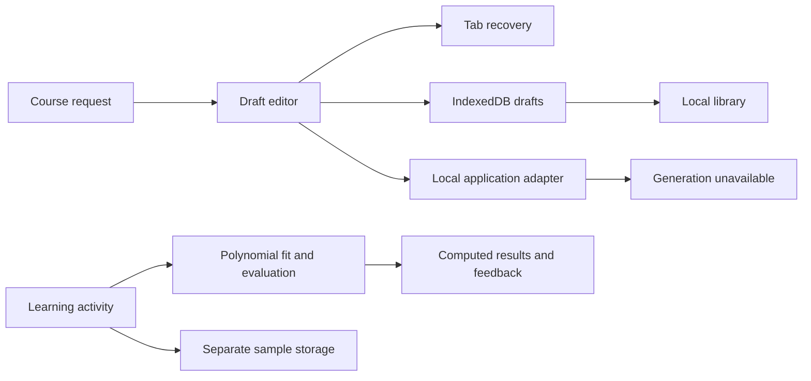

**Learn what you've always wanted to**

Unfurl is a learning workspace for turning a personal goal into a substantial course and studying through varied, interactive practice. Its intended experience combines a researched curriculum that the creator can review with a shared course whose support and next steps can differ for each learner.

This checkout currently provides the application foundation, real course-request drafts stored in the browser, and a working numerical learning activity. Live research and course generation are not connected yet. You can explore the interface and use these local features without an account or API key.

[Run locally](#run-locally) · [Try the learning activity](#try-the-learning-activity) · [Repository](https://github.com/DarinaX2005X/hackathon-ai)

Next.js **16.4.3** · React **19.3.1** · TypeScript **6.0.3** · Node.js **22.x**

## Contents

- [Current scope](#current-scope)
- [Run locally](#run-locally)
- [Save a course request](#save-a-course-request)
- [Try the learning activity](#try-the-learning-activity)
- [Storage and privacy](#storage-and-privacy)
- [How the application works](#how-the-application-works)
- [Planned complete service](#planned-complete-service)
- [Checks and evidence](#checks-and-evidence)
- [Application structure](#application-structure)
- [Planning and credits](#planning-and-credits)

## Current scope

The current experience is useful for preparing a learning goal and trying a concrete piece of interactive practice. It is also the foundation for the complete course service described in the planning documents.

| Available now | What it does |
| --- | --- |
| Product entry | An English landing with an unfolding course illustration, automatically rotating learning topics, and connected creation, exploration, and practice routes |
| Course-request editor | Write a goal, choose its intended content language, and add editable prompts about starting knowledge, outcomes, or time commitment |
| Local drafts | Explicitly save a request, reopen it from the library, rename it, and delete an individual draft |
| Request recovery | Recover unsaved text within the current tab session where browser storage is available, separately from a confirmed saved draft |
| Catalog and library surfaces | Browse the actual empty public collection and manage device-local drafts; cloud unavailability is distinguished from a signed-in empty library |
| Model-capacity activity | Fit real polynomial models to synthetic data, compare computed training and validation errors, and receive deterministic feedback |
| Help and privacy pages | Explain the current behavior, storage boundaries, and ways to manage local work |

The interface is English only. A draft's requested course language is independent of the interface language; choosing it does not imply that generation in that language is already available.

The current application has no connected AI provider, research service, authentication, production database, or durable cloud worker. Sending a course request returns an unavailable result while preserving the text. It does not generate a prerecorded reply, create a course, award account XP, or publish anything. The public catalog is empty because there are no released course records in the local adapter.

There is no public deployment URL at present. Vercel is the intended hosting target; a working local build is not a deployed service.

## Run locally

Use **Node.js 22.x** and npm. The exact dependency graph is committed in [package-lock.json](package-lock.json). No environment file, model key, database, or account is required for the current local features.

If you have not checked out the repository:

```sh
git clone https://github.com/DarinaX2005X/hackathon-ai.git
cd hackathon-ai
```

From the repository root:

```sh
npm ci
npm run dev
```

Open [http://127.0.0.1:3000](http://127.0.0.1:3000). Both development and production-start scripts bind to `127.0.0.1`. If Next.js reports a different port because the default is occupied, use the address printed in the terminal. Stop the server with `Ctrl+C`.

For a local production build:

```sh
npm run build
npm run start
```

The application does not require migrations or an AI configuration step in this delivery. Provider setup will be documented when real integrations exist; adding an arbitrary API-key environment variable does not enable generation.

## Save a course request

1. Open [Create a course](http://127.0.0.1:3000/create).
2. Describe something you want to learn and what you would like to be able to do. For example, a deep AI course can begin with fundamentals and continue into both creating models and building AI systems.
3. Choose the intended course language. The quick actions can add a starting point, outcome, or time commitment to the text for you to edit.
4. Use **Save draft** and wait for the saved confirmation.
5. Open [My library](http://127.0.0.1:3000/library), then reopen the draft, rename it, or delete only that record.

An existing draft opens through `/create?draft=<id>`. Changes remain distinguishable from the last confirmed save. A failed write does not become a saved success, and a missing or unreadable draft does not silently open a different record.

Submitting the request currently exercises the unavailable-service path. Your text stays available for editing and local saving; no course-generation run is accepted.

## Try the learning activity

Open [the model-capacity activity](http://127.0.0.1:3000/try). It explores a concrete question: why can a model fit its training points perfectly and still perform poorly on other points?

The activity uses a fixed, explicitly synthetic dataset. Training points follow `sin(πx)` with added noise; the separate validation points follow the same curve without that noise. You can change polynomial degree between **1, 3, and 7** and regularization between **0, 0.1, and 1**.

Each change recomputes the fitted coefficients, plotted curve, training error, and validation error. The numerical implementation solves the regularized least-squares problem with Householder QR and leaves the intercept unpenalized. The graph is accompanied by readable metrics and a data equivalent.

The task asks you to make a prediction, experiment with the controls, find a configuration whose validation RMSE is below **0.210**, and select an explanation for why zero training error is insufficient. More than one configuration can meet the target. Feedback evaluates the configuration and selected explanation separately, so a useful model choice and a mistaken conclusion are not collapsed into one opaque score.

You can use a hint, save a reflection, return to the activity, or reset it. Reflection text is retained but is not presented as AI-graded. Repeating an identical submission reuses its result, and the isolated activity awards **no account XP** or publication privileges.

Because the validation set is used to choose a configuration, its result is not an independent estimate of future performance. The activity explains this limit. It is one working teaching example, not a generated deep course or evidence of measured learning gains.

## Storage and privacy

Local work belongs to the current site's origin and browser profile. Keep using the same address when returning: `localhost`, `127.0.0.1`, and different ports have separate browser storage.

| Data | Storage | Removal and limits |
| --- | --- | --- |
| Unsaved request text and intended language | Tab `sessionStorage`, with an in-memory fallback | A recovery copy, not a saved library record; normal tab closure ends the session, though browser session restoration can restore it |
| Saved request title, text, language, IDs, and update time | IndexedDB | Delete the selected draft from the library; it is not synced to another device |
| Trial settings, attempts, feedback, hints, and reflection | A separate `localStorage` namespace | Use Reset in the activity; resetting the sample leaves course drafts intact |

The app reports storage failures and keeps usable input in the open page where possible. Browser storage is not a backup: clearing site data, changing profiles, or browser eviction can remove local work. There is no cloud copy from which Unfurl can restore it. Keep a separate copy of text you need to retain.

See the application's [privacy page](http://127.0.0.1:3000/privacy) for the current storage behavior and removal controls.

## How the application works

The UI uses one typed [ApplicationPort](src/application/ports.ts). The current [local adapter](src/application/local-adapter.ts) reports three unavailable capabilities: generation, cloud identity, and cloud persistence. It returns empty collection data, a not-found course lookup, and a safe generation-unavailable response before creating a message or run. These are real capability boundaries, not simulated remote services.

Local drafts use a separate [DraftStore](src/lib/drafts.ts). Their persistence remains usable even though the cloud capabilities are unavailable. The learning trial uses the shared task projection and renderer boundary, but its own sample session and deterministic evaluator.



[Zod schemas](src/domain/) validate data at the boundaries. Curriculum validation checks references, dependency cycles, outcome coverage, and revision-bound approval. The creator's [stream reducer](src/features/creator/stream.ts) handles typed events, replay, gaps, cancellation, and saved snapshots. Those contracts prepare the interface for future live integration; they do not mean that a model, event server, or course-generation backend is connected now.

## Planned complete service

The full intended experience goes beyond this local delivery:

1. A creator discusses a learning goal with an agent that performs real source research.
2. The agent proposes a curriculum with outcomes, prerequisites, and modules. The creator edits it and explicitly approves the current revision and content digest.
3. Durable generation researches individual modules, constructs supported interactive activities, checks their content and evaluation, and releases an immutable course version.
4. Each learner receives a separate enrollment, evidence record, and personal route. Support can change without deleting required outcomes or rewriting the shared course.
5. Real progress and XP follow an authoritative policy. Creators can share a specific version and, when eligible, explicitly publish it in the catalog.

The first substantial validation course is intended to cover AI foundations followed by both model creation and AI-system development. Several authored courses should be produced through the same engine once it works, rather than inserted as handcrafted substitutes for generation.

Model and research providers, identity, transactional storage, durable execution, evaluation coverage, and the production arrangement still need to be connected and verified. A single incorrect answer should not automatically trigger a large remedial detour. Adaptation must preserve the agreed depth and use relevant evidence. Neither that proposed policy nor the current activity establishes proven learning effectiveness.

The public planning documents describe the complete target and remaining decisions: [scope](devpost/scope.md), [product requirements](devpost/prd.md), [technical specification](devpost/spec.md), and [build checklist](devpost/checklist.md). They remain drafts and are not a completion report for future functionality.

## Checks and evidence

Run the complete repository check from the application root:

```sh
npm run check
```

This command runs route type generation and TypeScript checking, ESLint, Vitest, and the Next.js production build. It stops with a nonzero exit code when a check fails. Individual commands are also available:

| Command | Purpose |
| --- | --- |
| `npm run dev` | Start the local development server |
| `npm run typecheck` | Generate Next.js route types and check TypeScript |
| `npm run lint` | Run ESLint |
| `npm test` | Run the Vitest suite |
| `npm run check` | Run type checking, lint, tests, and build together |
| `npm run build` | Create a production build |
| `npm run start` | Serve an existing production build locally |

Tests cover draft persistence and failure handling, capability responses, curriculum and public-data invariants, catalog queries, creator recovery and event handling, numerical fitting, sample evaluation, isolated session persistence, and shared control contracts. The tests use explicit fixtures where a live service does not exist.

A fresh `npm ci` has been verified. Visual and interaction checks are separate from the automated suite. Automated results do not establish live AI integration, deployed durability, measured human comprehension, or learning efficacy.

## Application structure

| Area | Responsibility |
| --- | --- |
| [src/app](src/app/) | Next.js routes, root document, and metadata |
| [src/components](src/components/) and [src/styles](src/styles/) | Shared controls, navigation, visual tokens, and layout |
| [src/domain](src/domain/) | Runtime schemas, curriculum invariants, public projections, and typed errors |
| [src/application](src/application/) | Application port and current local adapter |
| [src/features/creator](src/features/creator/) | Request editor, recovery, curriculum view, and event reducer |
| [src/features/catalog](src/features/catalog/) and [src/features/library](src/features/library/) | Collection interfaces and local draft management |
| [src/features/learning](src/features/learning/) | Player, mechanic registry, numerical activity, evaluator, and sample session |
| [src/features/landing](src/features/landing/) | Product entry, authored illustration, help, and privacy content |
| [public/brand](public/brand/) | Unfurl mark and logo |
| [tests](tests/) and [scripts/check.mjs](scripts/check.mjs) | Automated checks and their runner |

## Planning and credits

Planning used the applicable [Devpost Learn Skill Pack](https://github.com/challengepost/learn-ai-basics) instructions for scope, product requirements, and technical specification.

The application uses [Next.js](https://nextjs.org/docs), [React](https://react.dev/), [TypeScript](https://www.typescriptlang.org/), and [Zod](https://zod.dev/). [Radix Dropdown Menu](https://www.radix-ui.com/primitives/docs/components/dropdown-menu) supports menu interaction, while dialogs use native browser modal behavior. [Lucide](https://lucide.dev/guide/react) supplies icons, and [Fontsource Manrope](https://fontsource.org/fonts/manrope) supplies the font through a declared package dependency. Font files are not copied into a committed font directory. The Unfurl mark and unfolding course illustration are authored application assets.

A project license has not been selected yet. Third-party dependencies retain their respective licenses; their inclusion does not imply an open-source license for this project.
