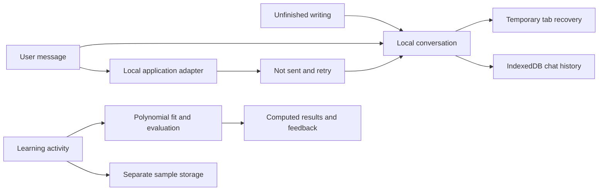

**Learn what you've always wanted to**

Unfurl is a learning workspace for turning a personal goal into a substantial course and studying through varied, interactive practice. Its intended experience combines a researched curriculum that the creator can review with a shared course whose support and next steps can differ for each learner.

This checkout currently provides a standalone local chat and a guided numerical learning activity. Live research and course generation are not connected yet. You can prepare a learning goal, return to your conversations, and use the activity without an account or API key.

[Run locally](#run-locally) · [Try the learning activity](#try-the-learning-activity) · [Repository](https://github.com/DarinaX2005X/hackathon-ai)

Next.js **16.4.3** · React **19.3.1** · TypeScript **6.0.3** · Node.js **22.x**

## Contents

- [Current scope](#current-scope)
- [Run locally](#run-locally)
- [Use the local chat](#use-the-local-chat)
- [Try the learning activity](#try-the-learning-activity)
- [Storage and privacy](#storage-and-privacy)
- [How the application works](#how-the-application-works)
- [Planned complete service](#planned-complete-service)
- [Checks and evidence](#checks-and-evidence)
- [Application structure](#application-structure)
- [Planning and credits](#planning-and-credits)

## Current scope

The current experience is useful for preparing a learning goal and trying a concrete piece of interactive practice. It is also the foundation for the complete course service described in the planning documents.

| Available now | What it does |
| --- | --- |
| Product entry | An English landing with an unfolding course illustration, automatically rotating learning topics, and connected creation, exploration, and practice routes |
| Local chat | Write an ordinary message or start with a complete editable learning scenario; conversations and unfinished writing are retained automatically on the current device |
| Chat history | Reopen, rename, or delete conversations in the chat; unavailable sends retain the actual user message with retry and edit actions |
| Catalog and library surfaces | Show the actual empty public collection and unavailable cloud library; library records are courses and enrollments, while conversations remain in chat |
| Guided model-capacity activity | Follow visual instructions, fit real polynomial models to synthetic data, compare computed errors, and receive deterministic feedback |
| Help and privacy pages | Explain the current behavior, storage boundaries, and ways to manage local work |

The interface is English only. The composer has no course-language selector. In the planned integrated service, the agent infers course language from the conversation and explicit intent, and the creator can edit it on the actual course artifact.

The current application has no connected AI provider, research service, authentication, production database, or durable cloud worker. Sending retains your user message with **Not sent** feedback and **Retry** or **Edit**. It does not create an assistant reply, accepted run, or course, award account XP, or publish anything. The public catalog is empty because there are no released course records in the local adapter.

There is no public deployment URL at present. Vercel is the intended hosting target; a working local build is not a deployed service.

## Run locally

Use **Node.js 22.x** and npm. The exact dependency graph is committed in [package-lock.json](package-lock.json). No environment file, model key, database, or account is required for the current local features.

If you have not checked out the repository:

```sh
git clone https://github.com/DarinaX2005X/hackathon-ai.git
cd hackathon-ai
```

From the repository root:

```sh
npm ci
npm run dev
```

Open [http://127.0.0.1:3000](http://127.0.0.1:3000). Both development and production-start scripts bind to `127.0.0.1`. If Next.js reports a different port because the default is occupied, use the address printed in the terminal. Stop the server with `Ctrl+C`.

For a local production build:

```sh
npm run build
npm run start
```

The application does not require migrations or an AI configuration step in this delivery. Provider setup will be documented when real integrations exist; adding an arbitrary API-key environment variable does not enable generation.

## Use the local chat

1. Open [New chat](http://127.0.0.1:3000/chat).
2. Describe something you want to learn and what you would like to be able to do. For example, a deep AI course can begin with fundamentals and continue into both creating models and building AI systems.
3. Alternatively, select a scenario card and edit the complete intention it places in the composer. If you already have text, a dialog lets you keep it or deliberately replace it. Cards never send automatically.
4. Write normally. **Saved on this device** appears only after storage confirms the write; a storage failure offers **Retry saving**. Opening an untouched empty chat creates no record.
5. Reopen the conversation under **Your chats**. Use **Chat options** to rename or delete it, or **New chat** to start another conversation.

Use Enter to send and Shift+Enter for a new line. Sending currently exercises the unavailable-service path: your actual message stays visible as **Not sent**. **Retry** reuses the same message and request identity. **Edit** lets you revise an unsent message and send it with a new identity; existing unfinished composer text must be finished or cleared first.

An existing conversation opens at `/chat?conversation=<id>`. Older `/create?draft=<id>` links redirect to the same conversation ID and import a valid legacy draft when available. Missing or unreadable records show a recovery state instead of silently opening another conversation.

A conversation is separate from its course results. The application contracts and artifact panel support multiple courses in one chat, each with its own metadata and curriculum. Live artifact creation is not connected in this checkout, so sending cannot populate that panel with a generated course. The library is reserved for actual courses and enrollments.

## Try the learning activity

Open [the model-capacity activity](http://127.0.0.1:3000/try). It explores a concrete question: why can a model fit its training points perfectly and still perform poorly on other points?

The visual guide introduces the orange model line, the circles it learned from, and the diamonds used to check its predictions. Choose **Let me try**, change the model's shape, then compare the result. Dotted gaps show where the line misses the new points. You can skip the guide or reopen it with **Show the guide** without changing your answer or hint history.

Choose **Straight**, **Curved**, or **Flexible**, and a bending limit of **None**, **Gentle**, or **Strong**. The goal is to reduce **Error on new points** below **0.210**, select an explanation for what you observed, and use **Check my model**. More than one configuration meets the target. Feedback evaluates the configuration and explanation separately.

The activity uses a fixed, explicitly synthetic dataset. Training points follow `sin(πx)` with added noise; the separate validation points follow the same curve without that noise. The three shapes correspond to polynomial degrees **1, 3, and 7**; the bending limits correspond to regularization values **0, 0.1, and 1**. **Look inside the model and data** exposes the technical details and values.

Each change recomputes the fitted coefficients, plotted curve, training error, and validation error. The numerical implementation solves the regularized least-squares problem with Householder QR and leaves the intercept unpenalized. The graph is accompanied by readable metrics and a data equivalent.

You can make an optional prediction, use a hint, keep a note, return to the activity, or reset it. Notes are retained but are not graded. Hints remain separately recorded as assistance; the orientation guide does not consume one. Repeating an identical submission reuses its result, and the isolated activity awards **no account XP** or publication privileges.

Because the validation set is used to choose a configuration, its result is not an independent estimate of future performance. The activity explains this limit. It is one working teaching example, not a generated deep course or evidence of measured learning gains.

## Storage and privacy

Local work belongs to the current site's origin and browser profile. Keep using the same address when returning: `localhost`, `127.0.0.1`, and different ports have separate browser storage.

| Data | Storage | Removal and limits |
| --- | --- | --- |
| Conversation title, unfinished writing, messages, delivery details, IDs, and timestamps | IndexedDB | Delete the selected chat through Chat options; it is not synced to another device |
| Pending conversation changes | Temporary tab `sessionStorage`, with an in-memory fallback | Protects writing until IndexedDB confirms it, then clears the recovery copy; it does not itself confirm a successful save |
| Imported legacy request and import/deletion metadata | IndexedDB | Original legacy drafts are retained. Deleting an imported chat prevents it from being imported again, but does not erase that original copy; clearing site data removes it |
| Trial settings, attempts, feedback, hints, and notes | A separate `localStorage` namespace | Use Reset in the activity; resetting the sample leaves conversations intact |
| Whether the trial guide was dismissed | A separate `localStorage` preference | Reopen it with Show the guide; changing this preference does not reset the activity |

Legacy import preserves the original ID, title, text, and update time. Its language metadata remains part of the import record, rather than becoming a composer setting or a course. Deleting a conversation does not delete any courses referenced by it. Clearing all site data also removes retained legacy copies, recovery data, and import/deletion markers.

The app reports storage failures and keeps usable input in the open page where possible. Browser storage is not a backup: clearing site data, changing profiles, or browser eviction can remove local work. There is no cloud copy from which Unfurl can restore it. Keep a separate copy of text you need to retain.

See the application's [privacy page](http://127.0.0.1:3000/privacy) for the current storage behavior and removal controls.

## How the application works

The UI uses one typed [ApplicationPort](src/application/ports.ts). The current [local adapter](src/application/local-adapter.ts) reports three unavailable capabilities: generation, cloud identity, and cloud persistence. It returns empty collection data, a not-found course lookup, and an unavailable response to `sendMessage` before accepting server work. The chat separately retains the user's actual local message and its failed delivery state. These are real capability boundaries, not simulated remote services.

Local conversations use [ChatStore](src/lib/chats.ts) and a [chat session controller](src/features/creator/chat-session.ts). The controller orders writes and keeps recovery state separate from confirmed persistence. The learning trial uses the shared task projection and renderer boundary, but its own sample session and deterministic evaluator.



[Zod schemas](src/domain/) validate data at the boundaries. Curriculum validation checks references, dependency cycles, outcome coverage, and revision-bound approval. The creator's [stream reducer](src/features/creator/stream.ts) handles typed events, replay, gaps, cancellation, and artifact snapshots. An `AgentTurnRun` represents a reply that can finish with zero, one, or several course artifacts; a separate `GenerationRun` represents course construction and requires an actual course and saved version for success. Finishing a reply does not mark a course ready. These contracts prepare the interface for future live integration; they do not mean that a model, event server, or course-generation backend is connected now.

## Planned complete service

The full intended experience goes beyond this local delivery:

1. A creator discusses learning goals with an agent that performs real source research. One conversation can create or edit several independent course artifacts.
2. A real course-creation operation supplies the initial title, summary, and content language. Each course has a curriculum with outcomes, prerequisites, and modules. The creator can edit its details and explicitly approve that course's current curriculum revision and content digest.
3. A separate course-building job researches individual modules, constructs supported interactive activities, checks their content and evaluation, and releases an immutable course version.
4. Each learner receives a separate enrollment, evidence record, and personal route. Support can change without deleting required outcomes or rewriting the shared course.
5. Real progress and XP follow an authoritative policy. Creators can share a specific version and, when eligible, explicitly publish it in the catalog.

The first substantial validation course is intended to cover AI foundations followed by both model creation and AI-system development. Several authored courses should be produced through the same engine once it works, rather than inserted as handcrafted substitutes for generation.

Model and research providers, identity, transactional storage, durable execution, evaluation coverage, and the production arrangement still need to be connected and verified. A single incorrect answer should not automatically trigger a large remedial detour. Adaptation must preserve the agreed depth and use relevant evidence. Neither that proposed policy nor the current activity establishes proven learning effectiveness.

The public planning documents describe the complete target and remaining decisions: [scope](devpost/scope.md), [product requirements](devpost/prd.md), [technical specification](devpost/spec.md), and [build checklist](devpost/checklist.md). They remain drafts and are not a completion report for future functionality.

## Checks and evidence

Run the complete repository check from the application root:

```sh
npm run check
```

This command runs route type generation and TypeScript checking, ESLint, Vitest, and the Next.js production build. It stops with a nonzero exit code when a check fails. Individual commands are also available:

| Command | Purpose |
| --- | --- |
| `npm run dev` | Start the local development server |
| `npm run typecheck` | Generate Next.js route types and check TypeScript |
| `npm run lint` | Run ESLint |
| `npm test` | Run the Vitest suite |
| `npm run check` | Run type checking, lint, tests, and build together |
| `npm run build` | Create a production build |
| `npm run start` | Serve an existing production build locally |

Tests cover chat persistence and migration, write failures, retry identity, capability responses, artifact-specific curriculum invariants, public-data projections, catalog queries, event handling, numerical fitting, sample evaluation, guide state, isolated session persistence, and shared control contracts. The tests use explicit fixtures where a live service does not exist, including multiple course artifacts and successful agent turns.

A fresh `npm ci` has been verified. Visual and interaction checks are separate from the automated suite. Automated results do not establish live AI integration, deployed durability, measured human comprehension, or learning efficacy.

## Application structure

| Area | Responsibility |
| --- | --- |
| [src/app](src/app/) | Next.js routes, root document, and metadata |
| [src/components](src/components/) and [src/styles](src/styles/) | Shared controls, navigation, visual tokens, and layout |
| [src/domain](src/domain/) | Runtime schemas, curriculum invariants, public projections, and typed errors |
| [src/application](src/application/) | Application port and current local adapter |
| [src/features/creator](src/features/creator/) | Chat history, composer, message delivery, course-artifact panels, and event reducer |
| [src/lib/chats.ts](src/lib/chats.ts) | Local conversation storage and legacy import |
| [src/features/catalog](src/features/catalog/) and [src/features/library](src/features/library/) | Public course, owned course, and enrollment interfaces |
| [src/features/learning](src/features/learning/) | Player, mechanic registry, numerical activity, evaluator, and sample session |
| [src/features/landing](src/features/landing/) | Product entry, authored illustration, help, and privacy content |
| [public/brand](public/brand/) | Unfurl mark and logo |
| [tests](tests/) and [scripts/check.mjs](scripts/check.mjs) | Automated checks and their runner |

## Planning and credits

Planning used the applicable [Devpost Learn Skill Pack](https://github.com/challengepost/learn-ai-basics) instructions for scope, product requirements, and technical specification.

The application uses [Next.js](https://nextjs.org/docs), [React](https://react.dev/), [TypeScript](https://www.typescriptlang.org/), and [Zod](https://zod.dev/). [Radix Dropdown Menu](https://www.radix-ui.com/primitives/docs/components/dropdown-menu) supports menu interaction, while dialogs use native browser modal behavior. [Lucide](https://lucide.dev/guide/react) supplies icons, and [Fontsource Manrope](https://fontsource.org/fonts/manrope) supplies the font through a declared package dependency. Font files are not copied into a committed font directory. The Unfurl mark and unfolding course illustration are authored application assets.

A project license has not been selected yet. Third-party dependencies retain their respective licenses; their inclusion does not imply an open-source license for this project.
